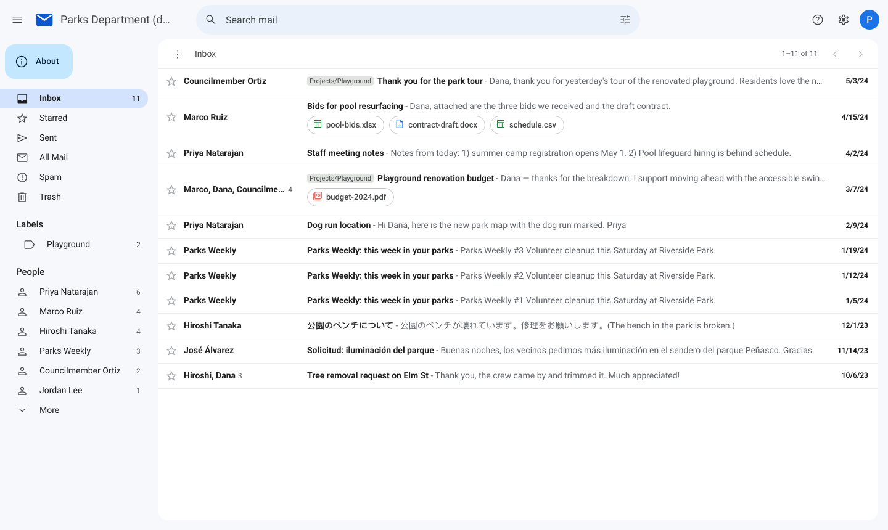
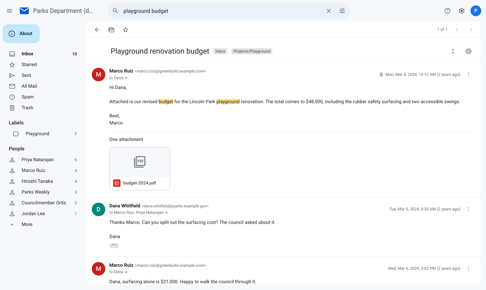
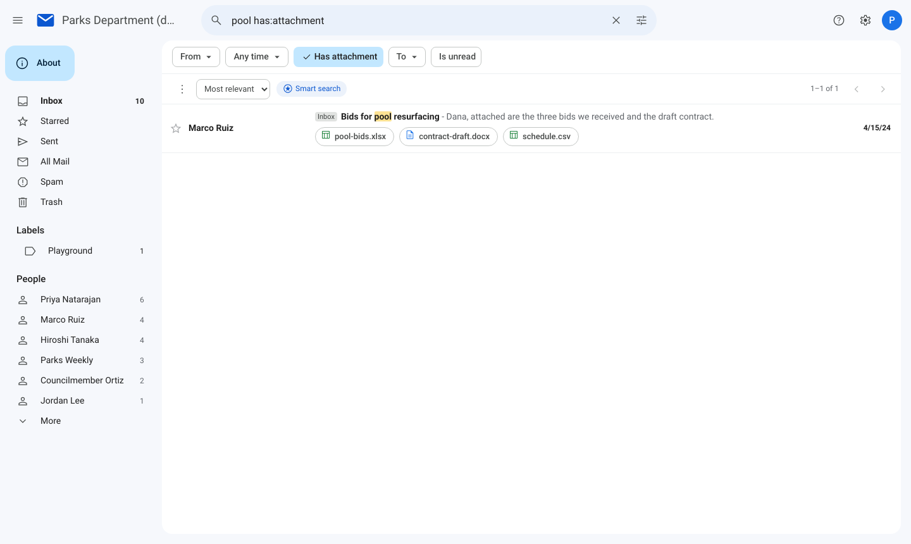

# Mailbox Viewer

[](https://github.com/rahimnathwani/mailbox-viewer/actions/workflows/ci.yml)
[](https://rahimnathwani.github.io/mailbox-viewer/demo)
[](LICENSE)

Turn an mbox or PST file into a static website that looks and works like Gmail: conversations, labels, attachments, Gmail's search operators and in-browser semantic search. There is no server. The build writes [Parquet files](docs/format.md) you can host on Cloudflare R2 or any static file host, and the viewer is a static site that queries them from the browser with DuckDB-WASM.

It was built for public-records and FOIA responses, which tend to arrive as a PST or mbox that most people can't open, let alone search or share.

**[Try the live demo](https://rahimnathwani.github.io/mailbox-viewer/demo)** (a fictional mailbox) · **[Documentation](docs/README.md)**



## Installation

```zsh
uv tool install git+https://github.com/rahimnathwani/mailbox-viewer
```

Smart search embeddings and building the viewer need [Node.js](https://nodejs.org) 20+; PST input needs `readpst` (`brew install libpst`). Or clone the repository and use `uv run mbv`, or use the [Docker image](docs/getting-started.md#docker). Details: [getting started](docs/getting-started.md).

## Usage

```zsh
mbv build ~/Downloads/response.pst --slug county-2026-05 --title "County records, May 2026"
mbv preview                     # http://localhost:8000/county-2026-05
mbv publish county-2026-05      # upload to Cloudflare R2
```

Deploy the viewer once (Vercel, Netlify, GitHub Pages or any static host) with `VITE_DATA_URL` pointing at the bucket. From then on, each new mailbox is just `build` and `publish`. See [publishing](docs/publishing.md).

## Features

| | |
|---|---|
| **Any mailbox export** | `.pst`/`.ost` (via readpst), mbox, Maildir/Maildir++, `.eml`; several at once, deduplicated, folders kept as labels |
| **Gmail's interface** | Conversations, labels, stars, read state, keyboard shortcuts, dark mode, mobile layout |
| **Gmail's search** | `from:`, `to:`, `subject:`, `has:attachment`, `filename:`, `before:`/`after:`, `label:`, `"phrases"`, `-exclusions`, `OR` ([all operators](docs/searching.md)) |
| **Search inside attachments** | Text extracted from PDF, Word, Excel, PowerPoint, RTF and attached emails |
| **Smart search** | A small embedding model runs in the browser and finds messages by meaning |
| **Static and cheap** | Opening a conversation fetches ~0.5 MB, even from a 50,000-message mailbox; nothing to run or patch |
| **Safe by default** | Email HTML is sanitized and sandboxed; remote images and tracking pixels stay blocked until you ask |
| **Open data** | Every mailbox is a set of [documented Parquet tables](docs/format.md) anyone can query with DuckDB, Polars or pandas |

| Conversation | Search |
|---|---|
|  |  |

## How it works

`mbv build` parses the mail, rebuilds conversations, extracts attachment text, and writes Parquet tables plus a word index sorted by term, so a search downloads only the few row groups that hold its words. Embeddings are computed with the same transformers.js model the browser later uses for queries. In the browser, DuckDB-WASM reads byte ranges of those files; nothing else is needed on the server. [Architecture](docs/architecture.md) covers the design decisions, performance and security model.

## Privacy

There is no login: anyone with the link can read what you publish, so review a mailbox with `mbv preview` before publishing it. Nothing is redacted for you.

## Contributing

Bug reports and pull requests are welcome; see [CONTRIBUTING.md](CONTRIBUTING.md). Please report security issues privately ([SECURITY.md](SECURITY.md)).

## License

[MIT](LICENSE)
