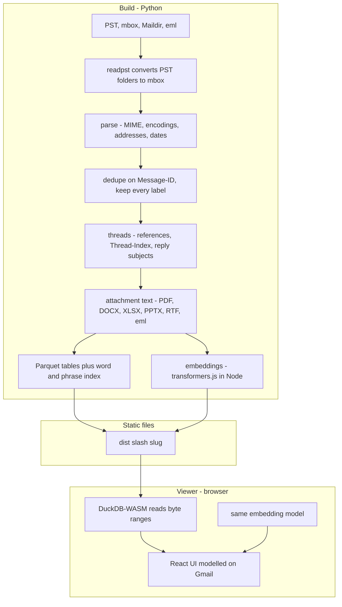

# Architecture

Mailbox Viewer has two halves that only share a file format: a Python **build** that turns mail into static files, and a static **viewer** that queries those files in the browser. There is no server-side code.

## Decisions

| Decision | Choice | Why | Cost |
|---|---|---|---|
| **No backend** | Static files on any host | Free or nearly free to host, nothing to patch, survives being forgotten | No login; everything published is public by URL |
| **Storage format** | Parquet, [documented](format.md) | Columnar: the viewer downloads only the columns and row groups a view needs; anyone can query it with DuckDB, Polars or pandas | A build step instead of serving mbox directly |
| **Query engine** | DuckDB-WASM | SQL over remote Parquet with range requests; Gmail operators become `WHERE` clauses | ~8 MB engine download (cached by the browser) |
| **Word search** | Inverted index in Parquet, sorted by term; BM25 computed in the browser | Row-group statistics on `term` let DuckDB fetch only the groups holding the query words, so the index scales without an upfront download | One range request per word; plural folding instead of stemming |
| **Phrases** | Index of adjacent word pairs | `"exact phrase"` without storing positions | Index roughly doubles |
| **Smart search** | `arctic-embed-xs` (q8), transformers.js at build (Node) and query time (browser) | Same code and weights on both sides, so vectors are comparable; small enough for phones | Every chunk vector is scored in the browser (fine to ~100k chunks) |
| **Fusion** | Reciprocal-rank fusion; meaning-only hits in their own section | Exact matches stay on top, as Gmail users expect | |
| **Threading** | References/In-Reply-To → Outlook Thread-Index → reply subject + shared participant within 120 days | PST exports often drop reply headers | Can split threads whose subject changed |
| **Bodies** | Sorted by thread, ~750 KB row groups | Opening a conversation is usually one range request | |
| **Attachments** | Individual files named by content hash | Direct links, browser PDF viewer, deduplication | Many small objects to upload |
| **Viewer stack** | Vite, React, TypeScript; Material Symbols; Roboto | Familiar to contributors; Vercel builds it with no configuration | |

## Performance

Measured with a synthetic 50,000-message mbox (188 MB) on an M1 Max, served locally:

| | 50k messages |
|---|---|
| **Build, word index only** | 94 s |
| **Build with embeddings** | 15 to 20 min (121k chunks at 130 to 150 chunks/s) |
| **Output** | 266 MB (46 MB vectors, 41 MB attachments) |
| **First load** | ~14 MB: conversation list, then message metadata in the background |
| **Word search** | 0.1 to 0.7 MB, 100 to 250 ms |
| **Open a conversation** | ~0.5 MB |
| **Smart search** | 23 MB model + 46 MB vectors once; then 150 to 350 ms per query |

Over the internet each search costs roughly 10 to 17 sequential range requests' worth of latency. Typical public-records responses (hundreds to a few thousand messages) build in seconds and load almost instantly.

## Security model

Mail is untrusted input, and the site is public.

| Threat | Mitigation |
|---|---|
| **Scripts in HTML mail** | DOMPurify sanitisation, then a sandboxed iframe without `allow-scripts`, under a restrictive CSP |
| **Tracking pixels and remote content** | Remote images, fonts and styles blocked until the reader asks; no request is even attempted |
| **Hostile attachments** | Only passive types (images, PDF, audio, video, plain text) are served inline; HTML, SVG, XML and scripts are served as plain text or downloads, locally and on R2. Previews are chosen by file extension, matching how the file is served |
| **Malformed files** | Per-message parse errors are counted and skipped; attachment text extraction has a 60 s limit per file |
| **Credentials** | Only `mbv publish`/`setup` use them, from `.env` (mode 600, git-ignored) |
| **Publishing too much** | Nothing is redacted for you. `--unlisted` hides a mailbox from the list but not from anyone with the URL |

## Third-party requests

By default the browser loads DuckDB-WASM and the ONNX runtime from `cdn.jsdelivr.net`, DuckDB's parquet extension from `extensions.duckdb.org`, and (for smart search) the model from `huggingface.co`. Build the viewer with `VITE_SELF_HOST=1` to serve all of them from your own site. There is no analytics.
