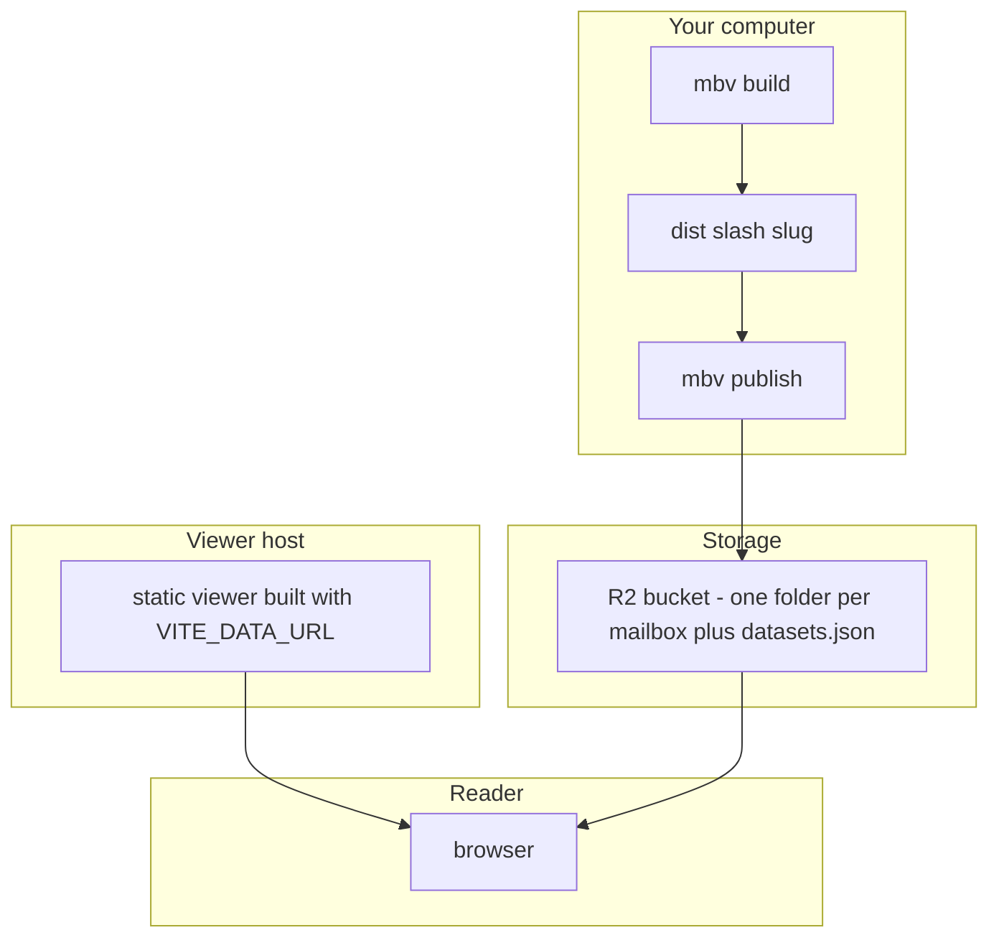

# Publishing

The viewer and the data are deployed separately. The viewer is a static site you deploy once; every mailbox is a folder of static files you upload to a bucket. New mailboxes never need a viewer redeploy.



## 1. Cloudflare R2 (once)

1. **Bucket**: Cloudflare dashboard → R2 → Create bucket (e.g. `mailboxes`).
2. **Public access**: bucket → Settings → Public access → enable the **R2.dev subdomain** to start (rate-limited), or connect a **custom domain** (needs a domain on Cloudflare; use it for real traffic).
3. **API token**: R2 → Manage API tokens → Create token with **Object Read & Write** on that bucket.
4. **Credentials**: run `mbv setup`. It asks for the account ID, key, secret, bucket and public URL, checks them, sets the bucket's CORS policy, tests a public range read, and writes `.env` (mode 600). Or copy [`.env.example`](../.env.example) to `.env` by hand.

## 2. Upload a mailbox

```zsh
mbv publish county-2026-05      # or: mbv publish --all
```

| Step | What happens |
|---|---|
| **CORS** | GET/HEAD from any origin, `Range` allowed, `Content-Range`/`Content-Length`/`Accept-Ranges`/`ETag` exposed |
| **Upload** | Only files the bucket doesn't already have (names are content hashes) |
| **Order** | Tables and attachments first, `manifest.json` last, so readers never see a half-uploaded mailbox |
| **Attachments** | Passive types (images, PDF, audio, video, plain text) inline; HTML, SVG, XML and scripts as text or downloads |
| **List** | `datasets.json` at the bucket root is updated (unlisted mailboxes left out) |
| **Check** | Reads the manifest through the public URL with a `Range` header from another origin |

`--prune` deletes files from older builds; `--dry-run` shows what would change. `mbv check` repeats the public-URL test at any time.

## 3. Deploy the viewer (once)

### Vercel

1. Push your clone to GitHub.
2. Vercel → Add New → Project → import it. [`vercel.json`](../vercel.json) sets the build; no framework preset needed.
3. Add the environment variable **`VITE_DATA_URL`** = the bucket's public URL.
4. Deploy. `/` lists the mailboxes; each lives at `/<slug>`.

`vercel.json` sends `X-Robots-Tag: noindex`; remove it if you want search engines to list the site.

### Anywhere else

| Host | Build | Output | Notes |
|---|---|---|---|
| **Netlify, Cloudflare Pages** | `npm ci --prefix viewer && npm run build --prefix viewer` | `viewer/dist` | Rewrite every path to `/index.html` (SPA) |
| **GitHub Pages** | as above, with `VITE_BASE=/<repo>/` | `viewer/dist` | Copy `index.html` to `404.html`; see the [demo workflow](../.github/workflows/demo.yml) |
| **Your own server** | as above | `viewer/dist` | Must answer range requests and fall back to `index.html` for unknown paths (`mbv preview` is a small example) |

Build-time settings:

| Variable | Default | Meaning |
|---|---|---|
| `VITE_DATA_URL` | `<base>/data` | Where `datasets.json` and the mailbox folders are |
| `VITE_BASE` | `/` | Path the viewer is served under, e.g. `/mailbox-viewer/` |
| `VITE_SELF_HOST` | unset | `1` bundles DuckDB-WASM, its parquet extension, the embedding model and the ONNX runtime, so the site makes no third-party requests (deploy grows from ~2 MB to ~145 MB; too big for Cloudflare Pages' 25 MB file limit) |

## Other storage

Any S3-compatible store works (AWS S3, Backblaze B2, Garage, SeaweedFS): set `S3_ENDPOINT_URL` in `.env`. It must allow CORS with the `Range` header, or be served from the same origin as the viewer. A plain web server that supports range requests can serve `dist/` directly; upload it with `rsync`.

## Custom domain later

Connect the domain to the bucket, change `R2_PUBLIC_URL` and `VITE_DATA_URL`, and redeploy the viewer. The data doesn't need uploading again.
